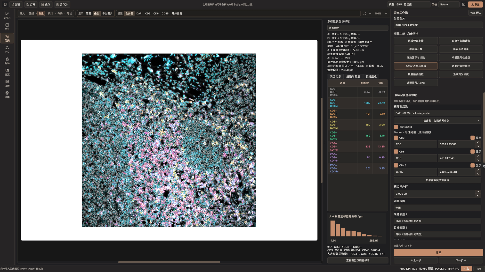
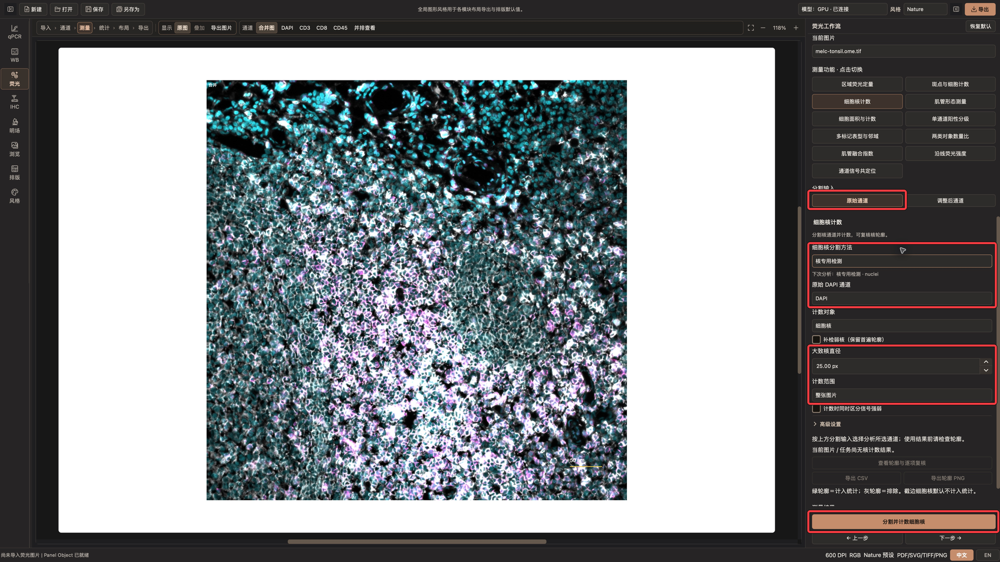
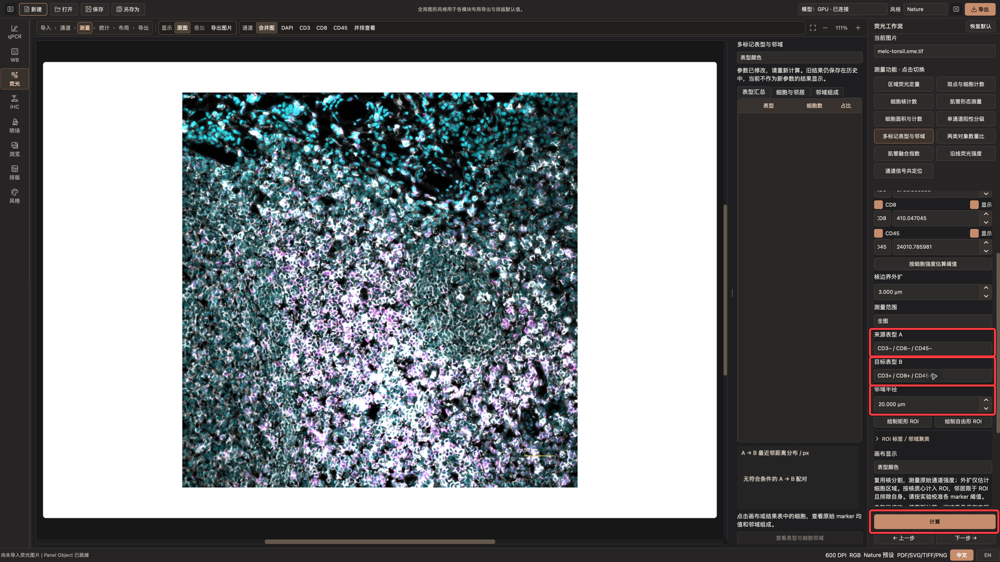
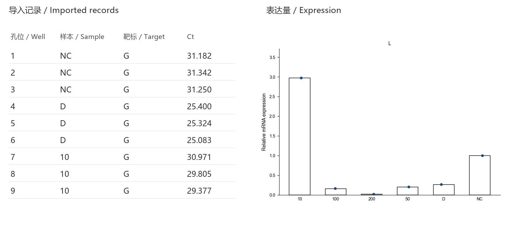
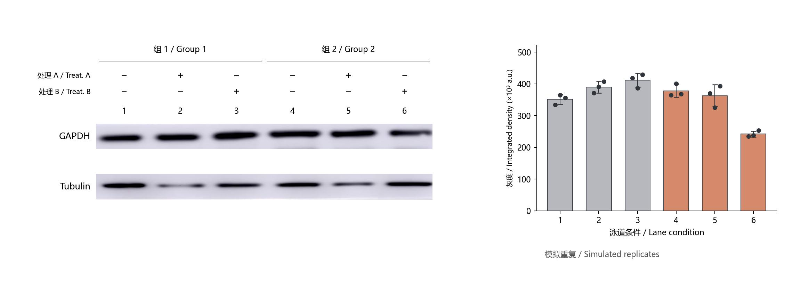
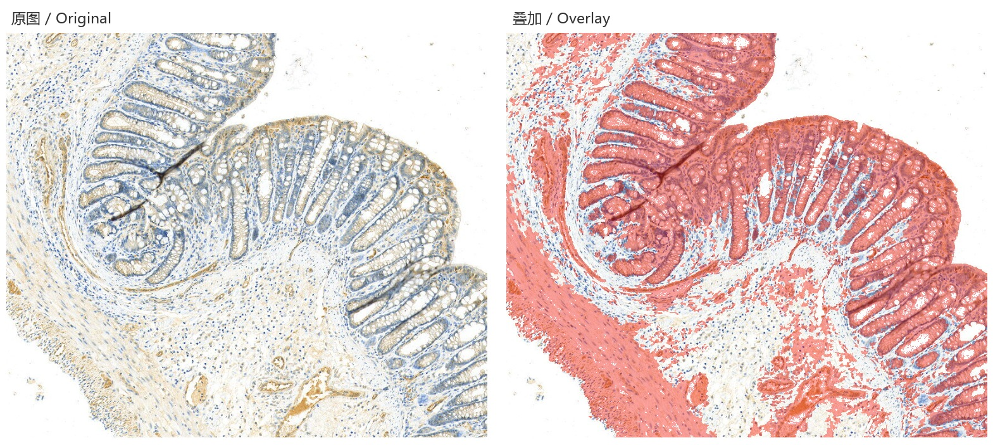
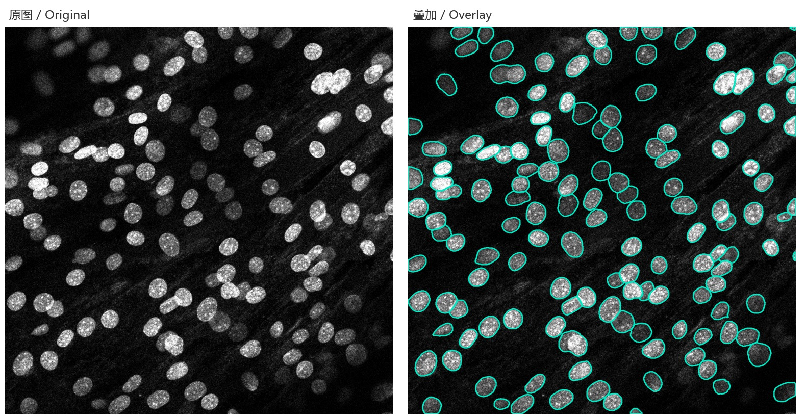
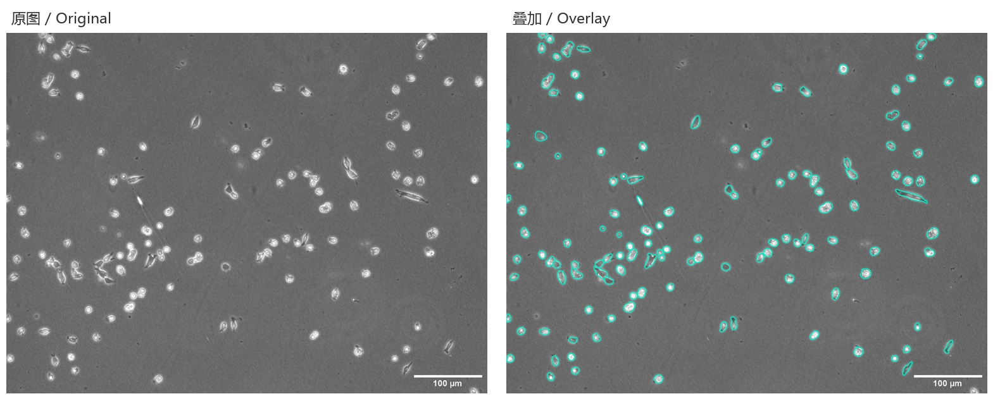
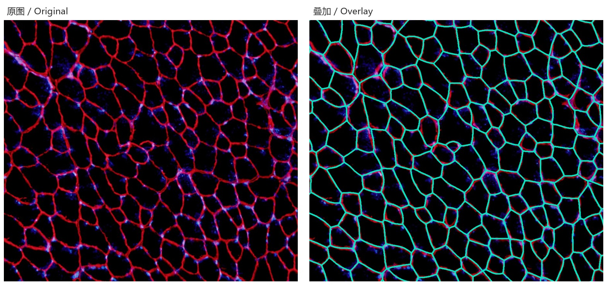
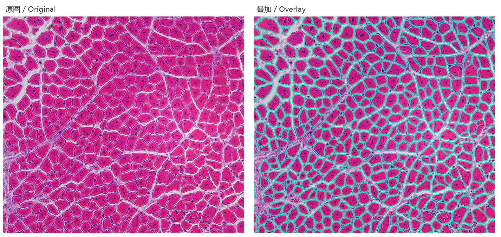

# ScieFig

科研数据与图像分析、绘图和组版。 
Scientific data and image analysis, plotting and figure assembly.

## 下载 / Download

### Windows 1.2.4

> [!IMPORTANT]
> **Windows 11 智能应用控制 / Smart App Control**
>
> 如果 ScieFig 启动失败、CPU/GPU 显示无连接或分析功能异常，并且 Windows 提示智能应用控制已阻止程序或组件，请暂时关闭智能应用控制，然后重启 ScieFig。入口是 **Windows 安全中心 → 应用和浏览器控制 → 智能应用控制设置 → 关闭**。
>
> If ScieFig fails to start, shows CPU/GPU as disconnected, or has analysis errors and Windows reports a Smart App Control block, temporarily turn off Smart App Control and restart ScieFig. Go to **Windows Security → App & browser control → Smart App Control settings → Off**.
>
> 此设置对整台电脑生效。 / This setting applies to the whole PC.

| 安装包 / Installer | 下载 / Download |
| --- | --- |
| 完整离线包，包含 CPU / NVIDIA GPU 运行库 / Full offline package | [Windows 完整安装包](https://github.com/pamelah-233/ScieFig-Community/releases/download/community-v1.2.4/ScieFig_1.2.4_Windows_Setup.exe) |
| CPU 基础包 / CPU package | [Windows CPU 安装包](https://github.com/pamelah-233/ScieFig-Community/releases/download/community-v1.2.4/ScieFig_1.2.4_Windows_CPU_Setup.exe) |
| 纯英文 CPU 包 / English-only CPU package | [Windows English CPU installer](https://github.com/pamelah-233/ScieFig-Community/releases/download/community-v1.2.4/ScieFig_1.2.4_Windows_English_CPU_Setup.exe) |
| NVIDIA GPU 补充包 / GPU component | [现有 GPU 补充包 / Existing GPU component](https://github.com/pamelah-233/ScieFig-Community/releases/download/community-v1.2.2/ScieFig_GPU_cellpose3_torch212_win64_v1.zip) |

CPU 基础包和纯英文 CPU 包可加装上方 NVIDIA GPU 补充包。 
The CPU and English CPU packages support the existing NVIDIA GPU component.

### macOS 1.2.4

**[macOS DMG · Apple Silicon](https://github.com/pamelah-233/ScieFig-Community/releases/download/community-v1.2.4/ScieFig_1.2.4_macOS_arm64.dmg)**

Mac 安装包包含运行库与离线模型，可在界面选择 CPU 或 Apple GPU。 
The Mac package includes runtimes and offline models, with CPU or Apple GPU selection.

1.2.4 打包源码 / Build source: [Windows](https://github.com/pamelah-233/ScieFig-Community/tree/6238fb4ba2a12ea80c9810715bc2f0deee35da3b) · [macOS](https://github.com/pamelah-233/ScieFig-Community/tree/a1b12f210979b2d7f075bafb567c60cffaaa6a4d)。源码快照中的旧下载链接仅作历史记录，请使用上方安装包链接。 / Use the installer links above; source snapshots can contain historical download links.

[1.2.4 更新详情 / What's new](https://github.com/pamelah-233/ScieFig-Community/releases/tag/community-v1.2.4) · [使用说明 / Getting started](docs/GETTING_STARTED.md) · [历史版本 / Previous releases](https://github.com/pamelah-233/ScieFig-Community/releases)

## 1.2.4 更新 / What's new in 1.2.4

- **ND2 导入修复 / ND2 import fix**：修复部分 ND2 导入后卡住或崩溃，Windows 安装包补齐旧版 ND2 所需的 JPEG 2000 解码器。 / Fixed freezes and crashes when opening some ND2 images; Windows installers now include the legacy JPEG 2000 decoder.
- **软件更新提示 / Update notice**：启动后在后台检查正式版，有较新的本平台安装包时显示下载入口。 / ScieFig checks for stable releases after startup and shows a link when a newer installer is available for your platform.

## 1.2.3 重要更新：多标记表型与细胞邻域
### New in 1.2.3: multi-marker phenotypes and cell neighborhoods

从多通道组织图像出发，在同一工作台完成核分割复核、标记组合识别和空间邻域分析。 
Review nuclear segmentation, classify marker combinations, and analyze cell neighborhoods in one workbench.

- **多标记表型**：复用 DAPI 核分割，按原始 marker 信号和可调整阈值识别组合。
- **最近邻距离**：选择来源表型 A 与目标表型 B，逐个计算 A 细胞到最近 B 细胞的核质心距离。
- **邻域组成与结果联动**：统计指定半径内的细胞，点选查看位置、marker 均值和邻居，支持 CSV 导出。
- **界面与性能**：修复分析完成时侧栏文字挤压；完整结果表按需加载，减少打开等待。

Reuse DAPI nuclei for marker combinations, calculate A→B nearest-neighbor distances, inspect radius-based neighborhoods, and export per-cell CSV results. Detailed result tables load on demand.

查看核分割和最近邻分析操作 / View the workflow screenshots

**图片来源 / Image credit**：Anna Pascual-Reguant et al., *Multiplexed histology analyses for the phenotypic and spatial characterization of human innate lymphoid cells*, **Nature Communications 12, 1737 (2021)**。[原论文 / Paper](https://www.nature.com/articles/s41467-021-21994-8) · [MELC 扁桃体原始数据 / Dataset](https://doi.org/10.5281/zenodo.3744152) · [CC BY 4.0](https://creativecommons.org/licenses/by/4.0/)。本例从同一视野选取 DAPI、CD3、CD8、CD45；伪彩、分割轮廓与界面截图由 ScieFig 生成。标记阈值应结合实验对照校准，图示组合不等同于已验证的细胞类型。 
Original tissue images are from the cited MELC dataset. ScieFig generated the false-color views, contours and interface screenshots. Marker cutoffs require experimental controls; displayed combinations do not establish cell identity.

## qPCR

Excel 一键导入，自动识别支持的仪器导出格式、样本、靶标和 Ct；选择内参和对照后计算并绘图。下图使用本机真实 Excel，展示导入记录和表达量，不进行显著性推断。 
Import Excel in one step to recognize supported instrument exports, samples, targets and Ct values. Select a reference gene and control to calculate and plot expression. The example uses a real local workbook and shows no significance inference.

## Western Blot

裁切条带、自动对齐，添加分组、处理和蛋白标记，并计算灰度。示例中两条带上下排列，分为两组、标出两种处理；右侧为带点柱状图：以实测灰度为中心生成每个条件的三个模拟重复，误差线为模拟点的标准差，仅展示绘图效果，不作为实验结果。分组与处理标签仅作排版示例。 
Crop and align strips, add group, treatment and protein labels, and measure density. Two strips are stacked with two groups and two treatment labels. The bar-and-dot chart uses three simulated replicates per condition centered on the measured density; error bars show their simulated standard deviation. It demonstrates plotting only and is not an experimental result. Group and treatment labels illustrate layout only.

## IHC

识别 DAB 阳性区域并测量面积，原图和叠加结果可切换检查。下图为同一局部视野。 
Detect DAB-positive regions and measure area, with original/overlay switching for review. The paired images show the same cropped field.

## 荧光核计数 / Fluorescence nucleus counting

选择通道进行核分割，使用优化核模型处理亮核和较暗的核，并逐个检查轮廓。显示调整与分割输入分别选择。 
Segment nuclei from a selected channel with the adapted nucleus model and review individual contours, including dim objects. Display adjustments and segmentation input are selected separately.

## 明场细胞测量 / Brightfield cell measurements

使用 Cellpose 分割细胞轮廓，统计个数、面积和尺寸；可使用局部对比增强策略。 
Use Cellpose to segment cells and measure count, area and size, with an optional local contrast normalization strategy.

## Laminin 膜分割 / Laminin membrane segmentation

根据 Laminin 通道识别肌纤维边界，得到单根纤维轮廓，用于计数和面积测量。下图为局部结果。 
Segment muscle-fiber boundaries from a Laminin channel to obtain individual contours for counting and area measurements. A cropped result is shown below.

## HE 肌纤维面积计数 / H&E muscle-fiber area and count

在 HE 图像中分割肌纤维横截面，计算个数与单根面积，并可复核分割结果。下图为局部结果。 
Segment muscle-fiber cross-sections in H&E images to measure counts and individual areas, with reviewable segmentation results. A cropped result is shown below.

配图由本机真实素材和软件分析接口生成。轮廓未进行人工补画；参数可根据图像调整，示例不代表所有图像都具有相同识别效果。 
Examples use real local materials and the application's analysis interfaces. Contours were not manually redrawn. Parameters can be adjusted for each image; these examples do not imply identical performance on all images.

## 组版与风格 / Layout and style

Composer 用于组合图片、图表、文字和图形，并导出图版。Style 支持从参考图像或 PDF 提取样式后应用于绘图。 
Composer assembles images, plots, text and shapes for figure export. Style extracts styles from reference images or PDFs for use in plotting.

## 运行源码 / Run from source

使用 Python 3.14，安装 `requirements.txt`，运行 `python main.py`。离线模型环境见[使用说明](docs/GETTING_STARTED.md)。Windows 安装版无需机器码激活。 
Use Python 3.14, install `requirements.txt`, and run `python main.py`. See the [guide](docs/GETTING_STARTED.md) for the offline model runtime. The Windows installer does not require device activation.

## 联系 / Contact

如需定制功能或反馈问题，可通过 [GitHub Issues](https://github.com/pamelah-233/ScieFig-Community/issues) 联系作者。 
For custom features or feedback, contact the maintainer through [GitHub Issues](https://github.com/pamelah-233/ScieFig-Community/issues).

[许可 / License](LICENSE) · [第三方声明 / Third-party notices](THIRD_PARTY_NOTICES.md)

