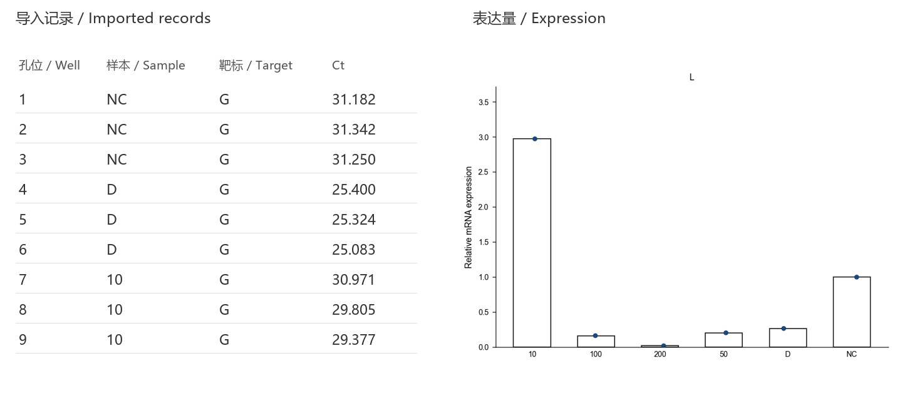
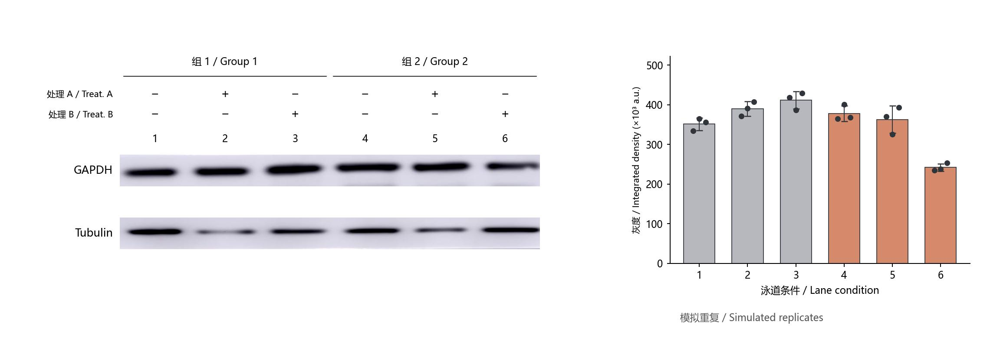
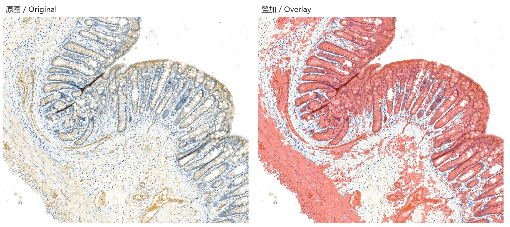
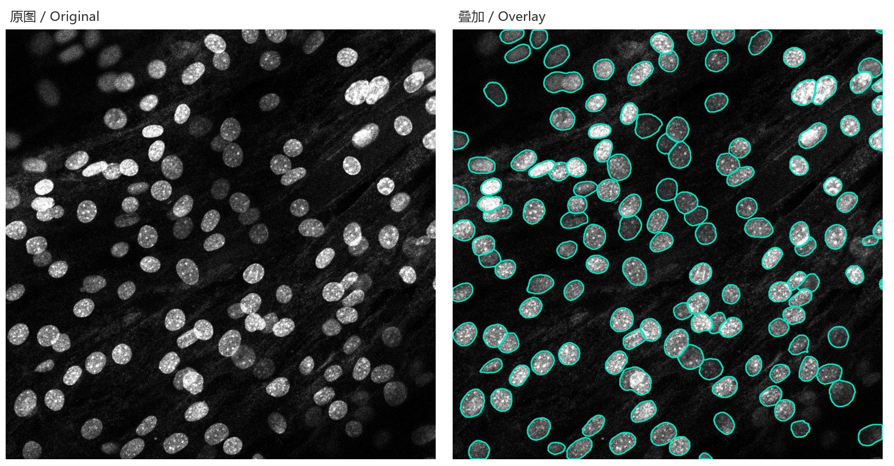
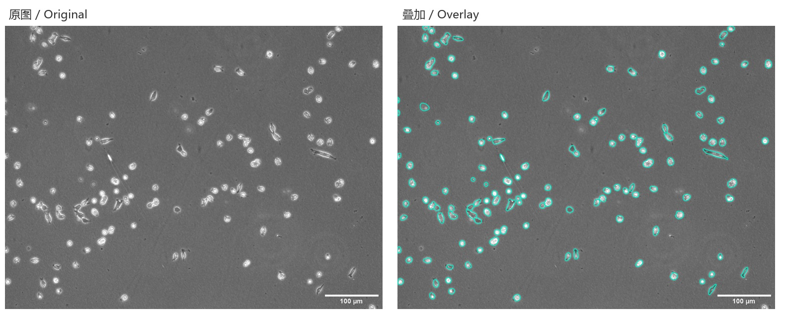
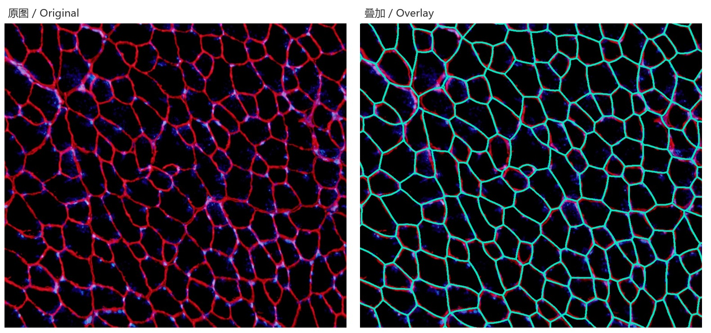
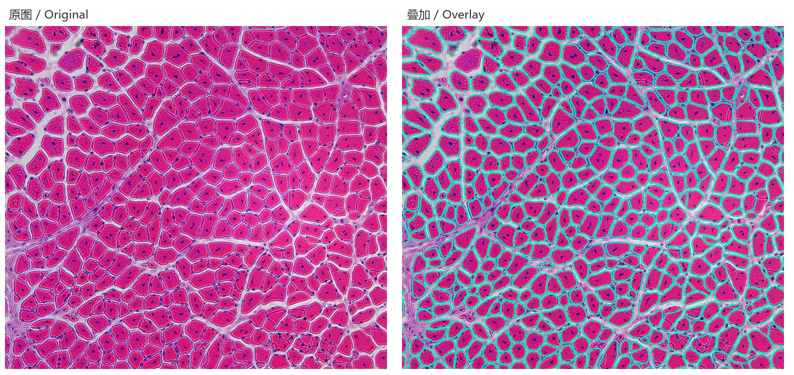

# ScieFig

科研数据与图像分析、绘图和组版。 
Scientific data and image analysis, plotting and figure assembly.

[下载 Windows 1.2.2 / Download Windows 1.2.2](https://github.com/pamelah-233/ScieFig-Community/releases/tag/community-v1.2.2) · [使用说明 / Getting started](docs/GETTING_STARTED.md)

## qPCR

Excel 一键导入，自动识别支持的仪器导出格式、样本、靶标和 Ct；选择内参和对照后计算并绘图。下图使用本机真实 Excel，展示导入记录和表达量，不进行显著性推断。 
Import Excel in one step to recognize supported instrument exports, samples, targets and Ct values. Select a reference gene and control to calculate and plot expression. The example uses a real local workbook and shows no significance inference.

## Western Blot

裁切条带、自动对齐，添加分组、处理和蛋白标记，并计算灰度。示例中两条带上下排列，分为两组、标出两种处理；右侧为带点柱状图：以实测灰度为中心生成每个条件的三个模拟重复，误差线为模拟点的标准差，仅展示绘图效果，不作为实验结果。分组与处理标签仅作排版示例。 
Crop and align strips, add group, treatment and protein labels, and measure density. Two strips are stacked with two groups and two treatment labels. The bar-and-dot chart uses three simulated replicates per condition centered on the measured density; error bars show their simulated standard deviation. It demonstrates plotting only and is not an experimental result. Group and treatment labels illustrate layout only.

## IHC

识别 DAB 阳性区域并测量面积，原图和叠加结果可切换检查。下图为同一局部视野。 
Detect DAB-positive regions and measure area, with original/overlay switching for review. The paired images show the same cropped field.

## 荧光核计数 / Fluorescence nucleus counting

选择通道进行核分割，使用优化核模型处理亮核和较暗的核，并逐个检查轮廓。显示调整与分割输入分别选择。 
Segment nuclei from a selected channel with the adapted nucleus model and review individual contours, including dim objects. Display adjustments and segmentation input are selected separately.

## 明场细胞测量 / Brightfield cell measurements

使用 Cellpose 分割细胞轮廓，统计个数、面积和尺寸；可使用局部对比增强策略。 
Use Cellpose to segment cells and measure count, area and size, with an optional local contrast normalization strategy.

## Laminin 膜分割 / Laminin membrane segmentation

根据 Laminin 通道识别肌纤维边界，得到单根纤维轮廓，用于计数和面积测量。下图为局部结果。 
Segment muscle-fiber boundaries from a Laminin channel to obtain individual contours for counting and area measurements. A cropped result is shown below.

## HE 肌纤维面积计数 / H&E muscle-fiber area and count

在 HE 图像中分割肌纤维横截面，计算个数与单根面积，并可复核分割结果。下图为局部结果。 
Segment muscle-fiber cross-sections in H&E images to measure counts and individual areas, with reviewable segmentation results. A cropped result is shown below.

配图由本机真实素材和软件分析接口生成。轮廓未进行人工补画；参数可根据图像调整，示例不代表所有图像都具有相同识别效果。 
Examples use real local materials and the application's analysis interfaces. Contours were not manually redrawn. Parameters can be adjusted for each image; these examples do not imply identical performance on all images.

## 组版与风格 / Layout and style

Composer 用于组合图片、图表、文字和图形，并导出图版。Style 支持从参考图像或 PDF 提取样式后应用于绘图。 
Composer assembles images, plots, text and shapes for figure export. Style extracts styles from reference images or PDFs for use in plotting.

## 运行源码 / Run from source

使用 Python 3.14，安装 `requirements.txt`，运行 `python main.py`。离线模型环境见[使用说明](docs/GETTING_STARTED.md)。Windows 安装版无需机器码激活。 
Use Python 3.14, install `requirements.txt`, and run `python main.py`. See the [guide](docs/GETTING_STARTED.md) for the offline model runtime. The Windows installer does not require device activation.

## 联系 / Contact

如需定制功能或反馈问题，可通过 [GitHub Issues](https://github.com/pamelah-233/ScieFig-Community/issues) 联系作者。 
For custom features or feedback, contact the maintainer through [GitHub Issues](https://github.com/pamelah-233/ScieFig-Community/issues).

[许可 / License](LICENSE) · [第三方声明 / Third-party notices](THIRD_PARTY_NOTICES.md)
